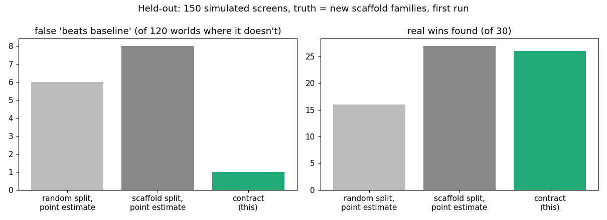

# A pre-registered evaluation contract for virtual compound screening

> Unofficial prototype by Kushagra Pratap Singh. Not affiliated with CellType.
> Every screen here is simulated, and the "candidate model" is a stand-in, not any real foundation model.

## The problem
CellType's offer to pharma partners is: *"Give us a held-out dataset, a quantitative endpoint, and the baseline to beat. We define the evaluation before we ask you to buy anything."* ([celltype.com](https://www.celltype.com)). Three things decide whether such an evaluation can be trusted:

1. **The split.** Compound screens come in analog series. A random split puts close analogs on both sides, so the test measures look-up, not prediction for "compounds your lab has never seen".
2. **The baselines.** Simple baselines are hard to beat at perturbation prediction. Five foundation models and two other deep models did not beat simple linear baselines in [Ahlmann-Eltze, Huber & Anders, Nature Methods 2025](https://www.nature.com/nature-index/article/10.1038/s41592-025-02772-6).
3. **The decision rule.** "Our mean is higher" on one split, with no interval, flips on the next dataset.

## What I built
`evalpact/` (numpy):
- **`world.py`** simulates a screen with known truth:
  - scaffold families of compounds as 1024-bit fingerprints (analogs share core bits);
  - mechanisms that come partly from pharmacophore bits shared across families (learnable, so it generalizes) and partly from the family (only learnable by having seen analogs);
  - mechanism → 200-gene response, plus plate effects and assay noise.
- **`models.py`** has three baselines (training mean, nearest analog by Tanimoto kNN, ridge on the fingerprint) and a candidate model. The candidate blends a real-but-noisy mechanism model (skill varies per world) with analog look-up (a "memo" share that varies per world).
- **`pact.py`** is the contract: a JSON file with a SHA-256 hash, frozen before scoring.
  - endpoint: per-compound Pearson of predicted vs measured response change;
  - split: scaffold-grouped;
  - comparison: against the best of the 3 baselines;
  - decision: **BEATS only if the one-sided 95% lower bound of (model − best baseline), bootstrapped over held-out families, is > 0**.

  It also writes a leakage report for any split: share of test compounds with a ≥ 0.8 Tanimoto analog in training, median nearest-neighbour Tanimoto, families and plates on both sides.
- **`evaluate.py`** builds many worlds. In each, the truth is whether the candidate beats the best baseline on **150 new scaffold families**. It compares three protocols against that truth:
  - random split + point estimate vs mean/ridge baselines (common practice);
  - scaffold split + point estimate;
  - the contract.

## Results: held-out, first run
150 simulated screens with a structure never run during development: more and smaller families, a noisier assay, stronger plate effects, and a different spread of model skill. The config was frozen in git before the run (`heldout/config.json`, commit 166078c). Nothing was changed after. Raw output: `out/heldout_first_run.json`.

| Protocol | False "beats baseline" (of 120 worlds where it doesn't) | Real wins found (of 30) |
|---|---|---|
| random split, point estimate, mean + ridge baselines | 6 | 16 |
| scaffold split, point estimate | 8 | 27 |
| **contract: scaffold split + family bootstrap lower bound > 0** | **1** | **26** |



**What the dev run showed that I didn't expect.** In the 150 dev worlds, the random split hardly ever claimed a win: 0 false, but it found only 1 of 31 real wins. Analogs on both sides made ridge and nearest-analog look strong, so the random split mostly measured look-up and missed models that really do better on new scaffolds. On held-out, with smaller families, it made 6 false claims and still missed about half of the real wins. Either way it measures the wrong thing; how it fails depends on the family structure.

**The bootstrap matters too.** On the same scaffold split, the point estimate made 8 false claims. The family-level lower bound made 1 and gave up 1 real win.

**Limits**
- Fingerprints are random bit vectors with family structure, not RDKit fingerprints of real molecules. The 0.8 Tanimoto near-duplicate flag barely fires in this simulation; the median nearest-neighbour Tanimoto (0.73 random vs 0.08 scaffold) and shared families are what show the leak. On real chemistry, use Morgan fingerprints and Bemis–Murcko scaffolds.
- The candidate model is synthetic. This tests the evaluation protocol, not any model.
- Not done here: hit-enrichment endpoints (top-k hit rate vs base rate, with a CI), and cross-species/tox endpoints. The same contract structure applies to both.

## Run it
```
python demo.py                  # one screen: the contract, leakage report, three verdicts, the truth
python evaluate.py heldout      # the table above (~1-2 min)
python -m unittest discover tests
```
Python 3.10+, numpy (matplotlib only for `docs/plot.py`).
